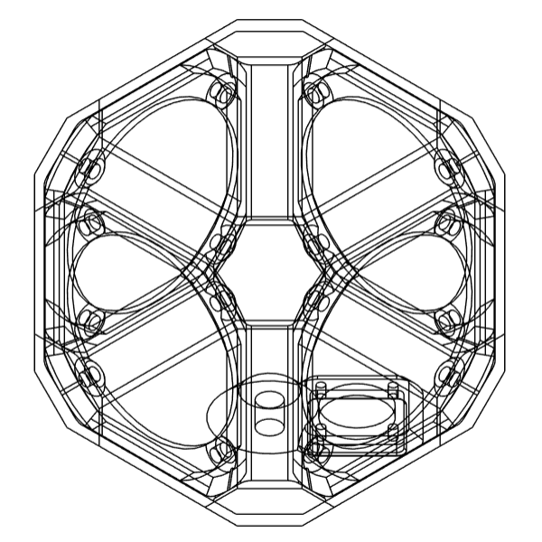

# Voxel

A compact first-order spherical loudspeaker array for direct–diffuse playback.
Four 4" drivers in a 3D-printed enclosure, developed at the Institute of
Electronic Music and Acoustics (IEM), Graz.

## Background

Compact spherical loudspeaker arrays like the IKO use the room actively: sound
is beamed towards walls or away from the audience, so the reflections become
part of the piece [1, 2, 3]. Placing several small first-order arrays around the listener
adds envelopment, and changing the ratio of direct to diffuse sound lets
sources appear at different distances [4, 5].

The IEM loudspeaker cubes [5] showed that this works. Voxel is an updated
version that is easy to build and can be 3D-printed.

## Files

| File | Description |
|---|---|
| [`Voxel4_v1.0.3mf`](Voxel4_v1.0.3mf) | Enclosure, 153 × 153 × 153 mm, one part |

## Building

Print the enclosure solid (100 % infill). The model is designed to need no
infill structure, which helps to avoid resonances.

| Qty | Part |
|---|---|
| 4 | Lavoce WSN041.00 drivers |
| 1 | Neutrik NL8MPRXX speakON connector |
| 16 | M5 brass inserts |
| 4 | M3 brass inserts |
| 2 | 5/8" brass inserts |
| 16 | M5 screws, flat head |
| 4 | M3 screws, countersunk |
| | Wiring |

## References

1. Frank, M., Sharma, G. K., Zotter, F., "What we already know about
   spatialization with compact spherical arrays as variable-directivity
   loudspeakers," 2015.
2. Zotter, F., Zaunschirm, M., Frank, M., Kronlachner, M., "A Beamformer to Play
   with Wall Reflections: The Icosahedral Loudspeaker," Computer Music Journal
   41(3), 2017. doi:10.1162/comj_a_00429
3. Zotter, F., Pomberger, H., "Models of spherical and rectangular cuboid
   loudspeaker arrays," 2019.
4. Deppisch, T., Meyer-Kahlen, N., Zotter, F., Frank, M., "Surround with Depth
   on First-Order Beam-Controlling Loudspeakers," 144th AES Convention, 2018.
5. Meyer-Kahlen, N., Zotter, F., Pollack, K., "Design and Measurement of
   First-Order, Horizontally Beam-Controlling Loudspeaker Cube," 2018.

## License

[CC BY-NC-ND 4.0](https://creativecommons.org/licenses/by-nc-nd/4.0/) –
Alexander Mülleder, Graz University of Technology / University of Music and
Performing Arts Graz
